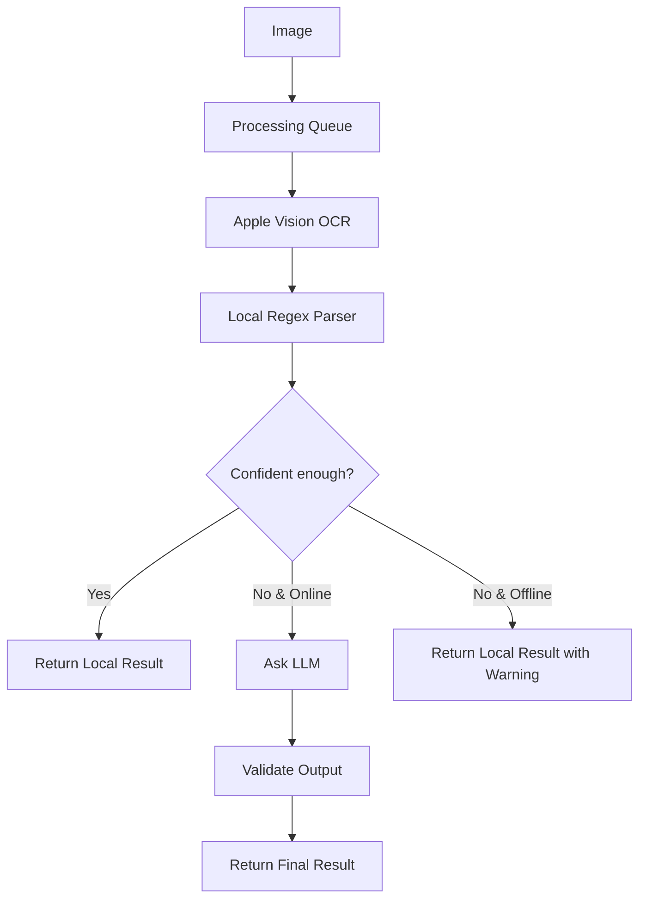

# HybridVisionPipeline

A lightweight Swift package for extracting product names, brands, and prices from photos. It combines Apple's Vision framework (local OCR), regex heuristics, and an optional LLM fallback (like Google Gemini).

---

## Why I Built This & Why It's Here

I initially built this as the backend engine for an iOS grocery shopping assistant app. The app itself had a full SwiftUI interface, SwiftData database, and cart calculations.

Technically, it worked. But when I actually took it to the supermarket to test it myself, I realized something important: **scanning every single price tag with a phone camera is just annoying in real life.** Even as the developer who spent weeks building it, I didn't actually want to use it while doing my grocery shopping. The user experience just didn't feel practical.

Instead of throwing away all the work I put into OCR parsing, regex matching, and the queue system, I decided to pull the core scanning logic out into its own standalone package and share it here. Maybe someone building an inventory tracker, receipt scanner, or just tinkering with on-device OCR + LLMs can find it useful.

---

## How It Works

Sending every single camera photo straight to a cloud LLM (like Gemini or GPT) is slow and gets expensive fast. Plus, supermarkets often have terrible cell service.

This pipeline tries to do as much as possible locally on the device first:

1. **Camera / Photo Input:** Grabs the image.
2. **Scan Queue:** Uses a Swift `actor` queue so scanning multiple items doesn't freeze the screen.
3. **Apple Vision OCR:** Reads the text directly on your iPhone (offline, fast, free).
4. **Local Regex & Heuristics:** 
   - Looks for product name and brand.
   - Tells the difference between the actual price and the unit price (like distinguishing 35 TL from 140 TL/kg).
   - Cleans up common OCR typos (e.g. `M1LK` -> `MILK`) and ignores junk text like "KDV" or dates.
   - Calculates a simple confidence score (0.0 to 1.0).
5. **LLM Fallback (Optional):** If the local parser isn't confident enough (confidence < threshold) and there is an internet connection, it sends the raw text to an LLM to figure out the rest.
6. **Result Validation:** A quick sanity check to make sure prices aren't negative or crazy high numbers.



---

## Features

- **On-Device OCR:** Uses Apple's native Vision framework (`VNRecognizeTextRequest`).
- **Smart Price Parsing:** Handles comma/dot decimals and ignores unit price lines.
- **Pluggable LLM:** Has a simple `LLMServiceProtocol`. Comes with a ready-to-use Gemini implementation, but you can plug in OpenAI, Claude, or a local CoreML model easily.
- **Actor-based Queue:** Handles multiple photos in the background with automatic retry.
- **Safe Fallback:** If the LLM call fails or times out, it gracefully falls back to whatever the local parser found.

---

## Quick Example

```swift
import HybridVisionPipeline
import UIKit

// 1. (Optional) Set up an LLM if you want fallback support
let gemini = GeminiLLMService {
    return "YOUR_API_KEY"
}

// 2. Create the pipeline
let pipeline = HybridImagePipeline(
    llmService: gemini,
    localConfidenceThreshold: 0.7 // Only call LLM if local score is below 70%
)

// 3. Process an image
Task {
    do {
        let result = try await pipeline.process(image: myImage)
        print("Product: \(result.data.productName)")
        print("Price: \(result.data.price)")
        print("Found via: \(result.source.rawValue)")
    } catch {
        print("Error: \(error)")
    }
}
```

If you have multiple scans coming in from a camera screen, you can use `ScanJobCoordinator`:

```swift
let coordinator = ScanJobCoordinator(pipeline: pipeline, maxConcurrentJobs: 2)

coordinator.onJobStatusChanged = { job in
    if case .completed(let result) = job.status {
        print("Done: \(result.data.productName) - \(result.data.price)")
    }
}

coordinator.submit(image: myImage)
```

---

## Tests

Run tests in Xcode with `Cmd + U`. Includes tests for:
- Price regex and unit vs selling price logic.
- Typo normalizations.
- Pipeline flow and mock LLM behavior.

---

## License

MIT License. Feel free to use, modify, or take parts of it for your own projects.
